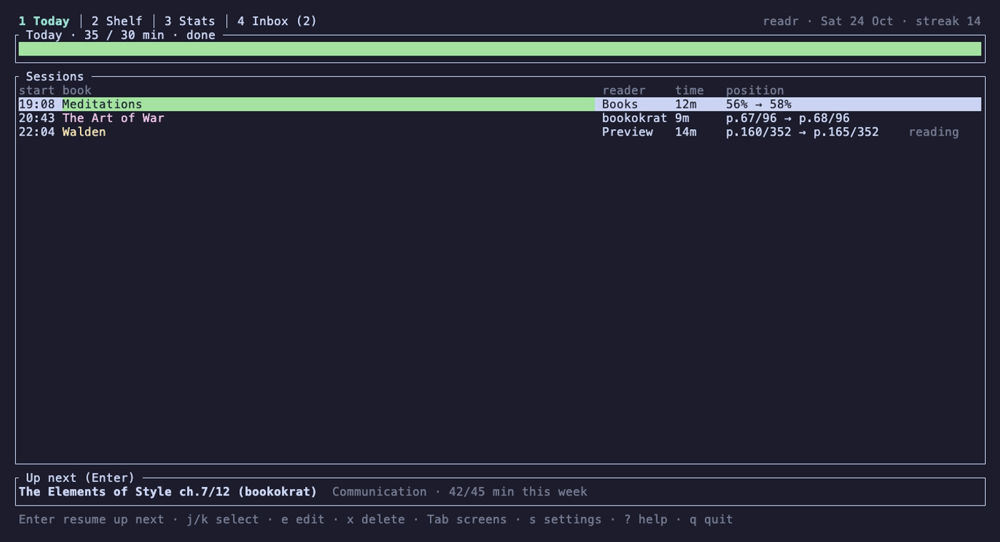
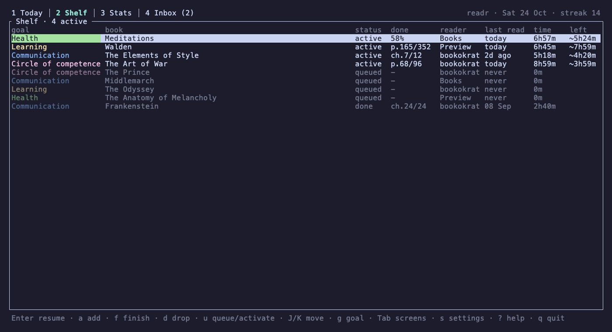
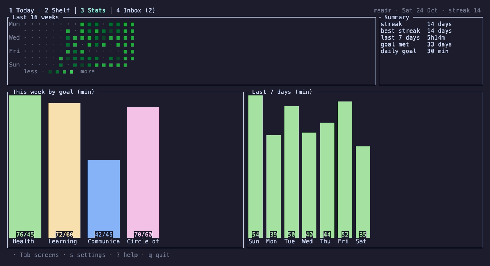
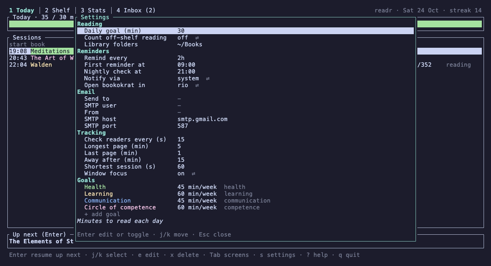

# readr

Track at least 20 minutes of reading a day across bookokrat, Preview and Apple Books. Remind in the terminal during the day, email at night if the goal was missed, and keep every reading session in SQLite.

You keep reading in your usual readers. A background daemon notices page turns and which reader is in front, records sessions, and reads each reader's own saved position, so readr never asks where you stopped.



| Shelf | Stats | Settings |
|---|---|---|
|  |  |  |

The screenshots use made-up data; `make demo` opens the same TUI on it.

## Requirements

- macOS (it reads macOS reader files and uses macOS APIs and launchd)
- Rust 1.88 or newer
- At least one of [bookokrat](https://github.com/bugzmanov/bookokrat), Preview or Apple Books
- Optional: [Rio](https://rioterm.com) to open bookokrat books in their own window, [herdr](https://github.com/herdrdev/herdr) as a notification channel or for opening books, and `terminal-notifier` (`brew install terminal-notifier`) for notifications with their own entry in Notification Center

## Install

```bash
make install            # lint + tests + release build, copies to ~/.local/bin/readr
readr init              # creates the database with the default goals
readr daemon install    # launchd agent io.github.shaunwen.readr, starts at login
readr doctor            # checks settings, readers, permissions, daemon, email
```

`make install BIN_DIR=<dir>` installs elsewhere; put lasting overrides such as `BIN_DIR` or `CODESIGN_IDENTITY` in an untracked `local.mk`. Make sure the directory is on your `PATH`.

Grant the installed `readr` two permissions in System Settings > Privacy & Security:

- **Full Disk Access**, to read the Apple Books library.
- **Accessibility**, to see which window is focused, so a page you read for longer than `max_page_minutes` still counts. The daemon asks for this on start.

macOS also asks once to let readr control Preview, to read which document is open.

macOS ties these grants to the binary's signature. An ad-hoc build changes it on every `make install`, so the grants would have to be given again. To keep them, create a code signing certificate once (Keychain Access > Certificate Assistant > Create a Certificate, Identity Type "Self Signed Root", Certificate Type "Code Signing", name `readr-dev`) `make install` signs with it whenever it exists (or pass `CODESIGN_IDENTITY=<name>`). `make install` also restarts a running daemon.

## Daily use

```bash
readr                         # TUI: Today, Shelf, Stats, Inbox
readr go [book]               # open the suggested book, or the one named, at its saved place
readr status                  # Today 12/20 min · streak 6, sessions, up next
readr status --short          # 12/20m, for a zsh RPROMPT
readr shelf                   # active books, queue, finished count, in your order
readr shelf add <title|path> [--goal health] [--queue]
readr shelf finish|drop|activate|queue <book>
readr shelf move <book> up|down|top|bottom
readr shelf set-goal <book> <goal|none> [--move-history]
readr log 25m "Atomic Habits" # reading away from the Mac
readr inbox                   # reading in books not on the shelf
readr inbox link <source> <book> | readr inbox ignore <source>
readr stats                   # last 7 days, streaks, minutes per goal this week
readr forget <book> [--keep-history] [--yes]   # stop tracking a book and delete its sessions
readr forget --list           # books readr no longer tracks
readr track <book>            # track a forgotten book again
readr goal rename <old> <new>
readr config                  # every setting and goal, as TOML
readr config set <key> <value>
readr config import [file]    # replace them all from a TOML file
```

TUI keys: `Tab`/`1-4` screens, `j`/`k` move, `Enter` resume, `a` add, `f` finish, `d` drop, `u` queue or activate, `J`/`K` move a book down or up, `g`/`G` set goal (G also moves past sessions), `e`/`x` edit or delete a finished session, `n`/`i` link or ignore an inbox item, `s` settings, `?` help, `q` quit.

## Reminders

- Every `remind.interval` (default 2h) from `remind.start` (09:00) until `nightly.at`, while today is under the goal: a notification such as `readr: 8 min to go today / Walden p.9/300 (bookokrat) · readr go`.
- Where notifications go is `notify.channel`:
  - `system` (default): macOS Notification Center through `terminal-notifier`, with sound, replacing the previous readr reminder. Install it with `brew install terminal-notifier`, then allow it under System Settings > Notifications (if it doesn't appear there, launch it once with `open -n "$(brew --prefix terminal-notifier)/terminal-notifier.app"`). Without it, readr falls back to `osascript`, where notifications show as "Script Editor".
  - `herdr`: `herdr notification show`, which follows herdr's own toast setting (`[ui.toast] delivery`), falling back to `system` when herdr isn't reachable.
- Once the goal is reached: one "done for today" notice, then nothing more that day.
- At `nightly.at` (default 21:00), if today is under the goal: a notification and an email. A check missed while the Mac slept runs on wake, the same day only. Each reminder is sent at most once.

Email is sent over SMTP with STARTTLS. Set `nightly.email_to` and `nightly.smtp_user` (settings popup or `readr config set`), then store the password (for Gmail, an app password) in the Keychain:

```bash
readr email set-password      # Keychain item "readr-smtp"
readr email test
readr notify-test
```

## Config

Settings and goals live in the database. Change them in the TUI with `s`, or with `readr config set <key> <value>`; the daemon picks changes up on its next poll. The first run imports `~/.config/readr/config.toml` if it exists (otherwise `crates/readr-core/src/default_config.toml`); after that the file is not read again. To edit everything as text, `readr config > file.toml`, edit, then `readr config import file.toml`.

In the TUI settings popup, Enter switches a choice or edits a value, Enter on a goal opens its fields, `J`/`K` reorder goals (the first one wins ties for up next), `d` removes a goal once no book on the shelf uses it, and the last row adds one.

- `daily_goal_minutes`
- `count_off_shelf`: whether reading outside the shelf counts toward the goal
- `library_dirs`
- `[remind]` interval and start
- `[nightly]` time and email
- `[tracking]` page gaps, `away_minutes`, `window_focus`
- `[launch] terminal = "rio" | "herdr"`
- `[[goal]]` entries with `key`, `label`, `color`, `weekly_minutes`, `folders`, `books_collections`

Goals are suggested for new books from their folder under `library_dirs`, or from their Apple Books collection.

## How tracking works

| Reader | Which book | Time | Position |
|---|---|---|---|
| bookokrat | `bookmarks.json` in each library under `~/Library/Application Support/bookokrat/libraries`; the focused window title, which bookokrat sets to its name, a dash and the file name | while its window is focused; otherwise time between page turns, each gap capped at `max_page_minutes`, plus `last_page_minutes` | page or chapter and `book_progress` |
| Preview | front document (AppleScript), only inside `library_dirs` | while it is the front app | `com.apple.Preview.ViewState.plist`, keyed by inode, so renames keep the page |
| Apple Books | most recently opened book in `BKLibrary-*.sqlite` (read-only) | while it is the front app | `ZREADINGPROGRESS` |

While a reader is in front, time counts even without keyboard or mouse input, so a long page counts in full. After `away_minutes` (default 15) without input, readr assumes you stepped away: the session is cut back to your last input plus `max_page_minutes`. Window focus works in any terminal whose window title follows the program's title (Rio does by default), but not inside herdr, whose window title is herdr's own. Turn it off with `tracking.window_focus = false`.

To stop tracking a book, `readr forget <book>` deletes its sessions (or keeps them with `--keep-history`), clears readr's copy of its saved place, takes it off the shelf after asking, and skips it from then on in every reader, including new copies with the same title. Removing a bookmark in the reader itself does none of that: readr keeps its own records. `readr track <book>`, or adding it to the shelf again, resumes tracking from the next session; deleted sessions stay deleted.

Sessions shorter than `min_session_seconds` are dropped. Sessions crossing midnight are split. Open sessions are saved on every poll, so `status` and the TUI include the session in progress, and a daemon restart loses nothing. Sessions you edit are never overwritten.

Data: `~/.local/share/readr/readr.db`. Daemon log: `~/Library/Logs/readr/daemon.log`.

## Development

```bash
make lint      # cargo fmt --check, clippy -D warnings
make test      # unit and CLI tests
cargo run -- daemon run   # tracker in the foreground
make demo      # TUI on made-up books and sessions in target/demo; your own database is never opened
make screenshots          # re-record docs/images with vhs (brew install vhs)
```

`readr-core` holds the config, database, session engine, reader adapters, schedule and suggestion logic. `readr` holds the CLI, daemon loop, notifications, email, launchd and the ratatui TUI. See [docs/design.md](docs/design.md) for the design.

## License

[MIT](LICENSE)
